# 02 · Features

> A complete list of what CampusWay can do, grouped by area. Each feature names the screen it lives on; see [03 · User guide](03-user-guide.md) for how to use it step by step.

**Contents:** [Campus map and route planning](#1-campus-map-and-route-planning) · [Search](#2-search) · [Accessibility profiles](#3-accessibility-profiles) · [Services near me](#4-services-near-me) · [Emergency shelter routing](#5-emergency-shelter-routing) · [Multi-building journeys](#6-multi-building-journeys) · [Indoor navigation](#7-indoor-navigation) · [Voice and audio](#8-voice-and-audio) · [Languages and settings](#9-languages-and-settings) · [Favourites, sharing and QR codes](#10-favourites-sharing-and-qr-codes) · [Live campus status and problem reports](#11-live-campus-status-and-problem-reports) · [Progressive Web App and offline use](#12-progressive-web-app-and-offline-use) · [Developer tools](#13-developer-tools)

---

## 1. Campus map and route planning

*Screen: campus map (`index.html`)*

| Feature | Description |
|---|---|
| Interactive campus map | Leaflet map of the University of Haifa limited to the campus area. It shows building outlines, building markers, gates, food places, shops, the clinic, smoking areas, the outdoor shelter, outdoor elevators and outdoor stairs. Building names appear when zoomed in. |
| Top bar | Only two buttons: the red **Nearest shelter** and **Settings** (gear). |
| Map key | Collapsible legend. Its open or closed state is remembered on the device (closed by default on phones). |
| Map icons for screen readers | Every map icon has a name in the current language (e.g. "Smoking area", "Elevator — Out of service"), which updates when the language changes. |
| "Show whole campus" control | Re-fits the map to the full campus. |
| Start point | Default is Carmel Gate. The user can type a building or room, speak it, or use the device GPS. The shelter button, shared links and class reminders start from the phone's position when no start is chosen and the phone is on campus; otherwise they start at Carmel Gate and say so. |
| Destination | A building, a room inside a mapped building, a food place, a shop, or a campus service. |
| Smart exit and entrance choice | For trips between buildings, every allowed exit of the start building is compared with every allowed entrance of the destination building. Each pair is scored by the indoor walk from the start room to the exit plus the outdoor route, and the fastest wins. |
| Animated route line | Dotted animated line from start to destination, snapped to the building markers. |
| Walking time (ETA) | Full-journey estimate in minutes. It includes the indoor legs, the outdoor leg, elevator waits and stairs. Mobility users are estimated at a slower outdoor walking speed. |
| "Your journey" | The route card lists the stages of the trip (e.g. *Inside Rabin Building → Walk outdoors → Inside Main Building*). Finished stages get a ✓ and the current one is highlighted. |
| Turn-by-turn directions | Outdoor directions such as *"Walk 100 m, then turn left near Rabin Building"*, with landmarks, stairs, and "passing X on your right" reassurance steps. |
| Live outdoor guidance | Once a route is drawn, the app follows the phone's GPS position along it: a blue dot with a direction cone, the current step highlighted, and the next turn read aloud when the Audio Guide is on. It pauses when the location is imprecise (over 30 m) or away from the route. |
| Phone direction strip | On a phone, the current direction and the distance to it sit in a strip at the bottom of the map. The **›** button opens the full *Directions* list; tap a step to hear it. |
| Cancel journey | **✕ Cancel journey** on the route card asks *"Cancel this journey?"* with *Yes* and *No*. |
| Outdoor arrival screen | When the outdoor walk is the last part of the journey, **"You have arrived!"** appears with *Done* and *New route from here* (which keeps the place as the next *From*). |
| Building popups | Each building has *Navigate here*, *Save to Favourites* and, for indoor-mapped buildings, *Report a problem*. |

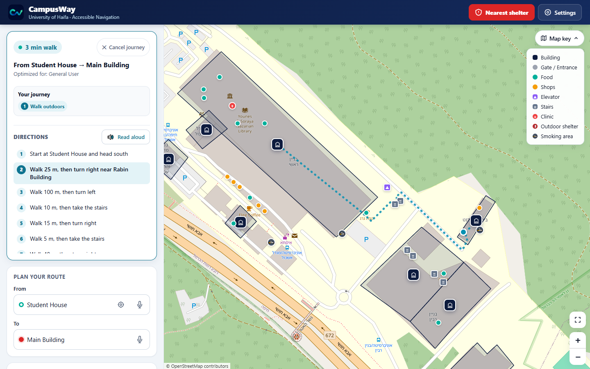

## 2. Search

*Screen: campus map. "From" and "To" fields*

| Feature | Description |
|---|---|
| Buildings | Matched by English and Hebrew names, plus aliases in English, Hebrew, Arabic and Russian (e.g. "Eshkol", "אשכול", "اشكول", "эшколь"). |
| Rooms and indoor places | Rooms, gyms, libraries, landmarks, the museum and parking, from all mapped buildings. Searching a room number shows the building and floor. |
| Kind words | Words like *elevator / lift / מעלית / مصعد / лифт* list the matching places, one result per building and label. |
| Service words | Words like *restroom, toilet, שירותים, حمام, туалет, shelter, ממ"ד, food, coffee, print, clinic, library, gym* offer a "Nearest …" suggestion near the start point. |
| Typo tolerance | Fuzzy matching allows 1 typo in words of 4 or more letters and 2 typos in words of 7 or more letters. Numbers have no typo tolerance and match as part of a room number ("500" lists 5001, 5002 …). |
| Script-aware matching | Ignores accents, Hebrew vowel marks (niqqud) and final letters, Arabic diacritics and letter variants, and Russian ё/е. |
| Helpful empty results | "No matching building or room found", or "This starting point is not mapped yet" for a known-format room number that is not mapped. |
| Keyboard and screen-reader support | Suggestion lists follow the ARIA combobox pattern and work with arrow keys, Enter and Escape. |

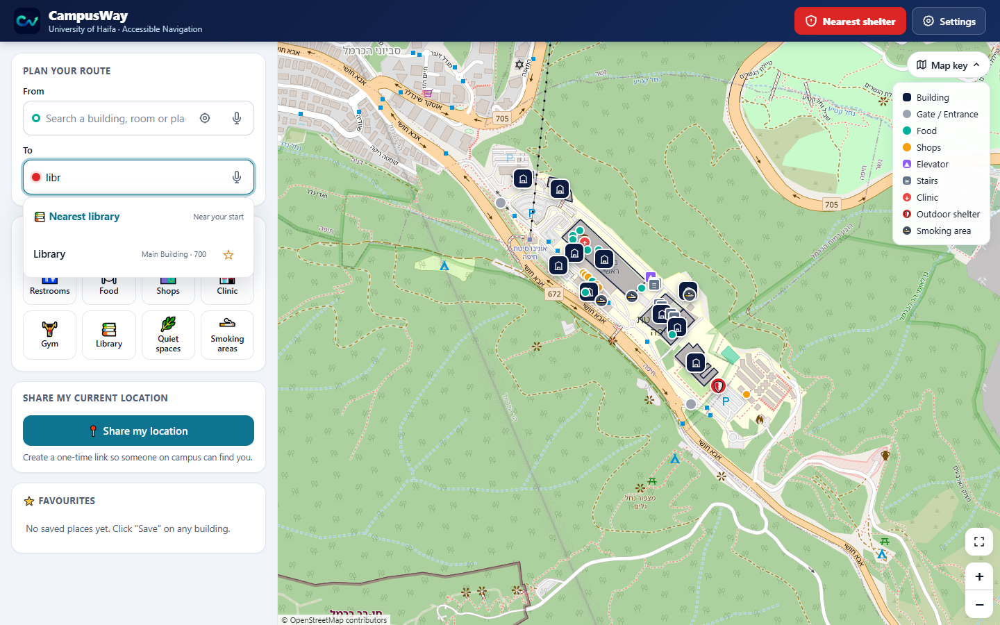

## 3. Accessibility profiles

*Screens: first-run setup (step 2) and Settings → Navigation profile. The choice is saved on the device and applies to routing on the campus map and indoors.*

| Profile | What changes |
|---|---|
| **General User** | Standard fastest route. Indoors, Phone Sensors mode. |
| **Mobility** (wheelchair / crutches) | Outdoor routes exclude steps. Entrances that need stairs are not used. Indoor routes use elevators only. The Rabin ↔ Terrace transfer always uses the shared elevator. Indoors, Manual / Wheelchair mode (tap *I reached the next point*) is used and step-free routing is locked on. Outdoor walking time is estimated at 0.8 m/s instead of 1.2 m/s. If no step-free route is mapped, the app says so instead of drawing an unsafe line. |
| **Visual Impairment** | Turns High Contrast and the Audio Guide on (both can be switched off in Settings). Adds **Plan route by voice**: spoken questions and answers for the start and destination, with **Stop voice planning** while it runs; choosing the profile in Settings starts it straight away. On Android phones it vibrates once before each turn, twice for a floor change and three times on arrival. Routes are the same as General User. |
| **Spatial / Navigation** | Prefers routes with fewer turns: each turn of 35° or more costs the same as 6 extra metres of walking. Applied both outdoors and indoors. Indoor instructions count down to the next point, e.g. *"Turn left, then continue · about 12 m, then turn right"*. |
| **Sensory & Wellbeing Support** | Prefers quieter outdoor paths: paths through areas marked noisy or crowded in the live campus status count as five times longer (not for shelter routes). Adds **🌿 I need a break**, which routes straight to the nearest reachable rest space. The *Quiet spaces* service button is called **Rest Spaces**. |

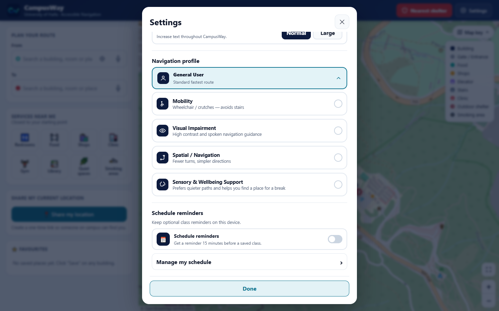

## 4. Services near me

*Screen: campus map. "Services near me" grid; distances are measured from the start point*

| Button | Behaviour |
|---|---|
| Restrooms | Routes to the nearest building that has a mapped restroom, continuing indoors to it. |
| Food | Highlights all food places on the map. A place's popup offers *Navigate here*. |
| Shops | Highlights all shops (including printing and the minimarket). |
| Clinic | Routes to the campus clinic. |
| Gym | Routes to the nearest mapped gym, continuing indoors to it. |
| Library | Routes to the nearest mapped library, continuing indoors to it. |
| Quiet spaces / Rest Spaces | Highlights the reachable quiet spaces on the map (🌿), each with its floor and walking time. Pick one and choose *Navigate here*; the route continues indoors to it. With the Sensory & Wellbeing profile the button is called **Rest Spaces**. |
| Smoking areas | Routes to the nearest smoking area by walking distance (step-free for the Mobility profile). |

There is no shelter button here: use the red **Nearest shelter** button in the top bar ([section 5](#5-emergency-shelter-routing)).

Tapping an active button again cancels it.

| Food places highlighted | Rest-space suggestions |
|---|---|
| 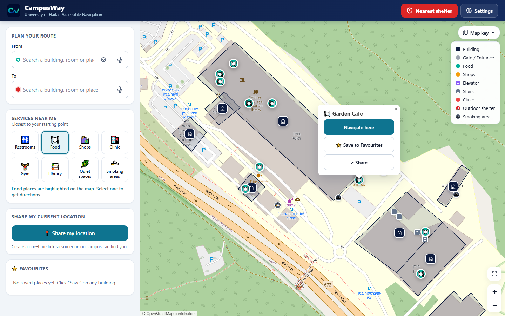 | 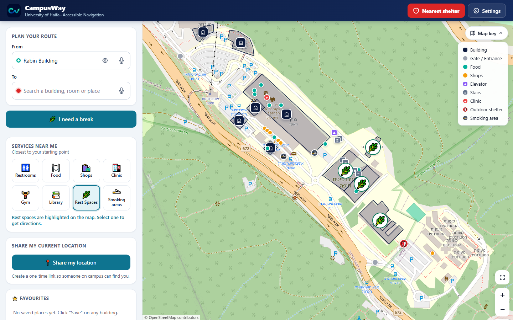 |

## 5. Emergency shelter routing

*Screens: campus map and indoor navigation. Red "Nearest shelter" button*

- One tap finds the fastest reachable shelter. It compares real outdoor routes plus indoor walking time for every mapped shelter, and the outdoor shelter on the campus map.
- A shelter the app can guide you to indoors is preferred, unless another shelter is at least 60 seconds closer.
- Starts from the chosen *From* point. With no start chosen, it uses the phone's position when the phone is on campus; otherwise it starts at Carmel Gate and says so.
- For the Mobility profile, only shelters with a step-free route are offered.
- The route card turns red and is marked 🛡️. *Continue indoors* leads to the shelter room on the floor plan.
- The indoor page has its own shelter button. If the current building has no mapped shelter, it returns to the campus map in emergency mode.
- When the campus team turns on an emergency in the live status, a red banner with a **Nearest shelter** button appears on both pages.
- Can be opened directly with the link parameter `?emergency=1`.

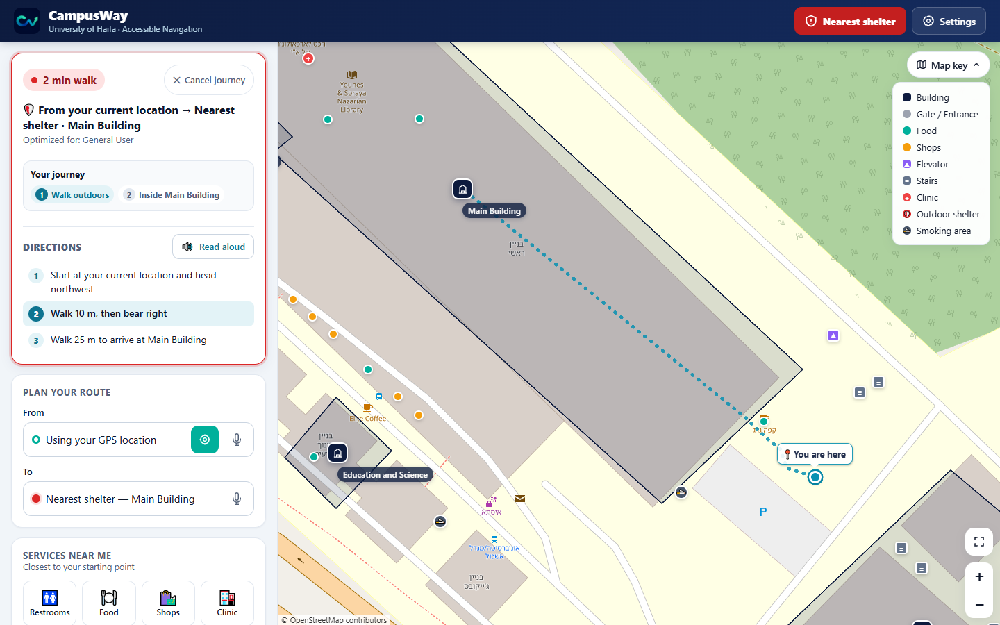

## 6. Multi-building journeys

*Screens: campus map and indoor navigation*

| Feature | Description |
|---|---|
| Room-to-room routing | Start in a room in one building and end in a room in another. The journey is split into an indoor origin leg, an outdoor leg, and an indoor destination leg, shown as stages under *Your journey*. |
| Start indoors first | When the trip starts in a room, the route card shows **Start indoor route →**; the outdoor directions appear after the exit is reached. |
| Hand-off at the exit | Reaching the exit of the origin building shows *"You reached the exit"* with **Continue outdoors →** (back to the campus map with the outdoor leg drawn and live guidance running) or *Cancel journey*. |
| Continue indoors | **Continue indoors →** appears when the phone is within about 25 m of the destination entrance. If the location is unavailable, it appears with the hint *"Tap Continue indoors when you reach the entrance."* |
| Same-building routing | If start and destination are in the same building, there is no outdoor leg; *Start indoor route* opens indoor navigation straight away. |
| Rabin ↔ Terrace shared transfer | These buildings connect directly: by stairs (Rabin floor 5 ↔ Terrace floor 4), or by the shared elevator for step-free routes. No outdoor leg is needed. At the connection the app shows *"You reached the connection"* with **Continue →**. |
| Main ↔ Terrace chain | Main floor 600 → bridge → Rabin → shared connection (elevator for step-free routes, otherwise stairs) → Terrace. |
| Shared-elevator continuity | A pending elevator ride is kept when the app switches from one building's floor plan to the next, so the user only confirms "I exited on Floor X". |
| Journey resume | If the page is reloaded mid-journey, the outdoor leg is rebuilt from the saved journey state. |

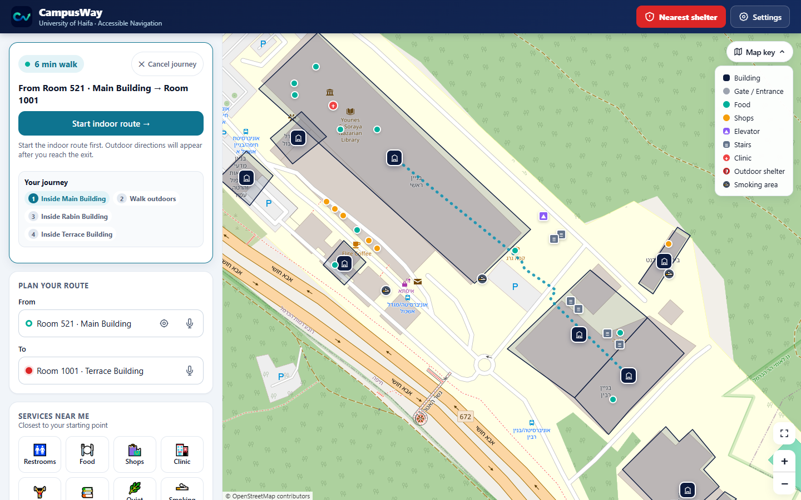

## 7. Indoor navigation

*Screen: indoor navigation (`wayframe/navigation-demo.html`)*

| Feature | Description |
|---|---|
| Schematic view | Default view: the route over a light outline of the corridor network, which is easy to read on a phone. |
| Floor-plan view | "Show floor plan" in the top bar overlays the architectural drawing of the floor. |
| Floor selector | Lists the floors the route passes through. Floor changes are marked on the map, e.g. "⇅ Elevator · Floor 2" or "↗ Stairs · Floor 5". |
| Zoom and pan | Buttons, mouse wheel, drag, and a *Recenter* button. |
| Step list | Numbered indoor instructions such as *"Walk 10 m, then turn right near Stairs"* and *"Take the elevator down to Floor 2"*, with nearby rooms as landmarks. Tap a step to hear it. On a phone the current step sits in a strip over the map, with the full list one tap away. |
| Navigation banner | Large turn arrow with the current instruction and destination. |
| Your journey | The same stage list as on the campus map, so the user knows which part of the trip this is. |
| Automatic mode choice | The mode buttons are hidden; the mode is chosen for the user. Mobility profile → **Manual / Wheelchair**. Demo mode (`?demo=1`) → **Auto**. Everyone else → **Phone Sensors**. |
| **Phone Sensors mode** | The marker moves along the planned route as the phone detects steps (about 0.65 m each). The map rotates heading-up. The user confirms stairs and elevator floor changes, and near the end confirms with **✓ I have arrived** (or **✓ I reached the exit**), because the position is only an estimate. |
| Tap-to-confirm fallback | If motion-sensor permission is refused or the device has no usable motion sensors, the app switches to tap-to-confirm checkpoints on the same route (stairs stay allowed) instead of stopping. |
| **Manual / Wheelchair mode** | No sensors. The route is split into checkpoints (turns, elevator entry and exit), and the user taps **✓ I reached the next point**; at an exit, **✓ I reached the exit — continue outdoors**. *Previous point* goes back. Step-free routing is locked on. |
| **Auto mode** | Demo mode only: the marker walks the whole route by itself, pausing at floor changes. |
| Arrival dialog | "You have arrived!" with *Done* (back to the campus map) and *New route from here* (back to the campus map with this room as the next *From*). |
| Cancel journey | **← Campus map** asks *"Cancel this journey?"* with *Yes* and *No*. |
| How it works | The ⓘ button explains how position tracking and confirmations work. |
| Nearest shelter | Red button that routes to the nearest shelter in this building (see [section 5](#5-emergency-shelter-routing)). |

| Route on the floor plan | Manual / Wheelchair mode |
|---|---|
| 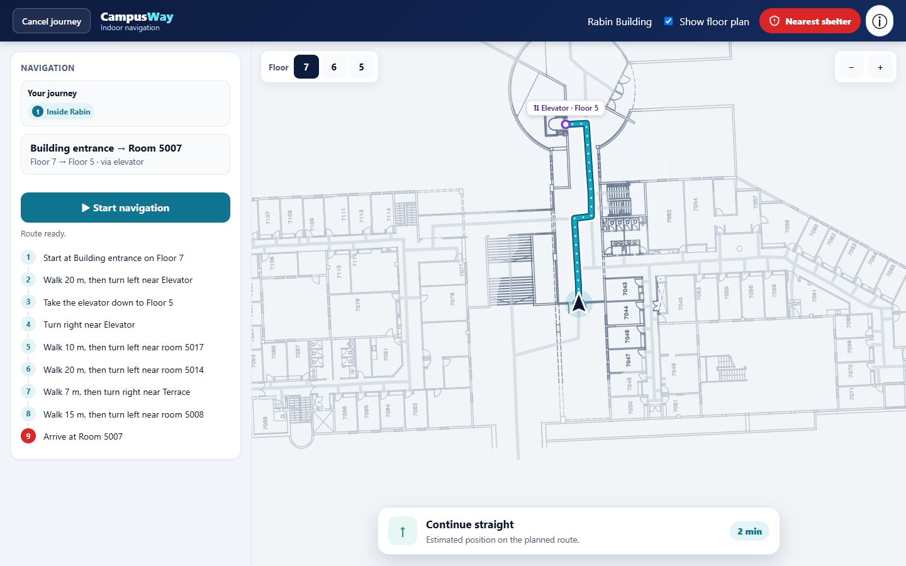 | 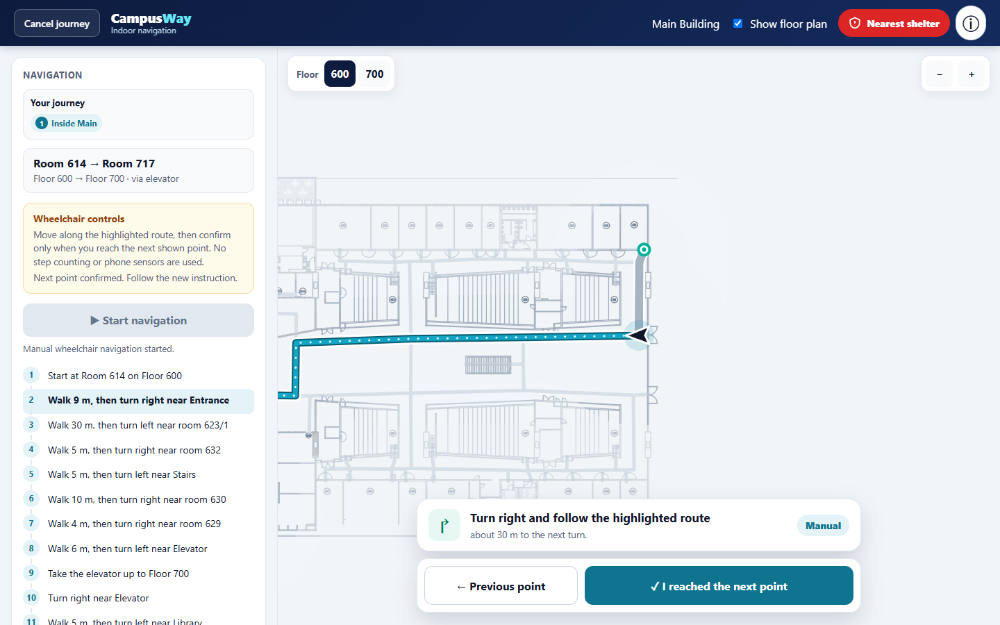 |

## 8. Voice and audio

| Feature | Where | Description |
|---|---|---|
| Audio guide | Settings | Speaks confirmations, route summaries and directions on the campus map. The setting is kept on the device and also controls indoor voice guidance. |
| Read directions aloud | Campus map | Reads the turn-by-turn list and highlights the step being read. Tap a single step to hear only that step. |
| Spoken live guidance | Campus map | With the Audio Guide on, the next turn is read aloud as the phone approaches it during the outdoor walk. |
| Voice guidance | Indoor navigation | Speaks each new instruction automatically when the Audio Guide is on. |
| Voice search | Campus map | Microphone buttons on *From* and *To* use speech recognition in the current language, with a live voice-level indicator. |
| Plan route by voice | Campus map, Visual Impairment profile | CampusWay asks where you are starting (a room, a building or "use my location") and where you want to go, then plans the route and offers to open indoor navigation. The spoken questions are in English, Hebrew or Arabic. |
| Missing-voice notice | Both pages | If the phone has no voice for the chosen language, nothing is spoken (an English voice would read only the numbers) and a short card explains how to add a voice on that kind of device. |
| Vibration | Both pages, Visual Impairment profile | On Android phones: one pulse before a turn, two for a floor change, three on arrival. iPhones do not support vibration from web pages. |

## 9. Languages and settings

- Full interface in **English, Hebrew, Arabic and Russian**.
- Right-to-left layout for Hebrew and Arabic, including arrows, dialogs and map popups. Russian is left-to-right.
- Directions, indoor instructions, floor names, map icon names and spoken guidance follow the chosen language.

| Feature | Description |
|---|---|
| First-run setup | Two steps: **1. Choose your language**, **2. Choose your navigation profile**. Both are saved on the device (`localStorage`), so the next visit opens straight on the map. |
| Settings dialog | The gear button in the top bar. It contains **Language**, **High Contrast**, **Audio Guide**, **Text size** (*Normal* or *Large*), **Navigation profile** and the optional **Schedule reminders**. Every choice is saved on the device; language, display, audio and profile also apply on the indoor page. |
| Schedule reminders | Optional. After turning it on, *Manage my schedule* lets the user add classes (name, day, time, and a room or building from the list). While CampusWay is open, a *"Class soon"* card appears 15 minutes before a saved class, with **Start route**. The schedule stays on the device. |

| Hebrew | Arabic |
|---|---|
| 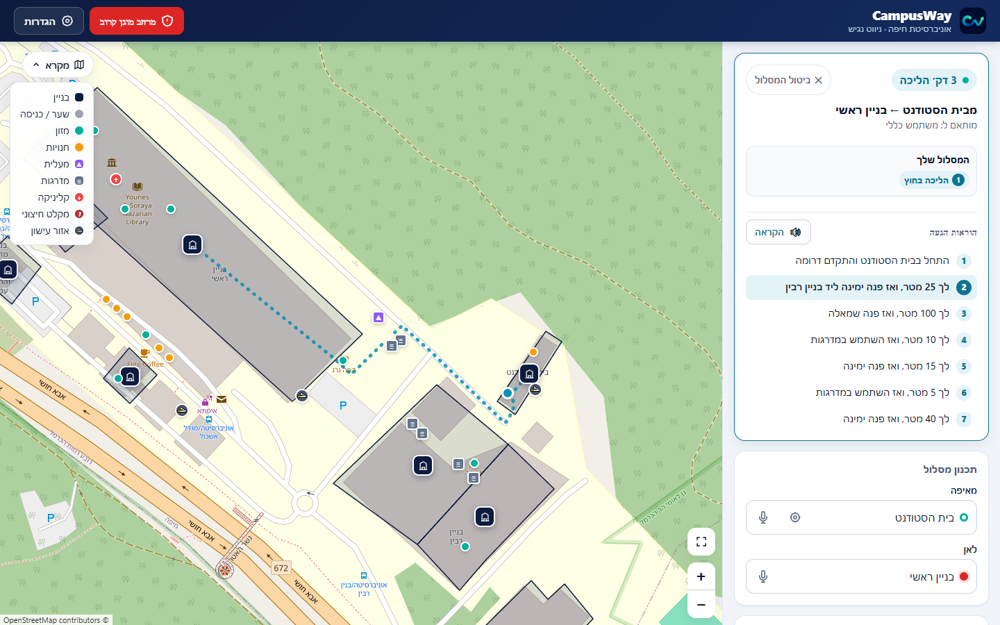 | 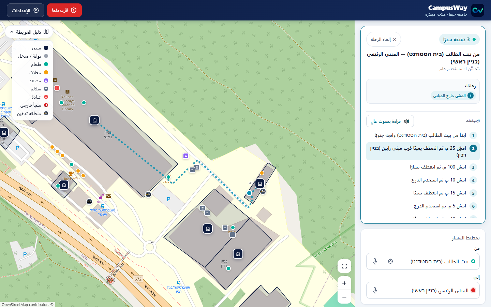 |

## 10. Favourites, sharing and QR codes

| Feature | Description |
|---|---|
| Favourites | Save buildings, food places, shops, smoking areas and quiet spaces from their popup, and rooms with the ☆ in search results. The *Favourites* panel lists them for one-tap routing. They are stored on the device. |
| Share a place | Food places, shops and the clinic have *Share* in their popup. It creates a link that opens CampusWay with that place as the destination. If the person who opens it has not chosen a start, directions start from their phone's position on campus (otherwise from Carmel Gate, with a message). |
| Share my location | Creates a one-time link (and QR code) with the phone's current position, so someone on campus can find you. The link opens CampusWay with a route to that spot. |
| QR code | The share dialog shows a QR code, generated offline by the app's own encoder, that can be downloaded as a PNG. Uses the phone's native share sheet when available, or *Copy link*. |

| Favourites | Share dialog with QR code |
|---|---|
| 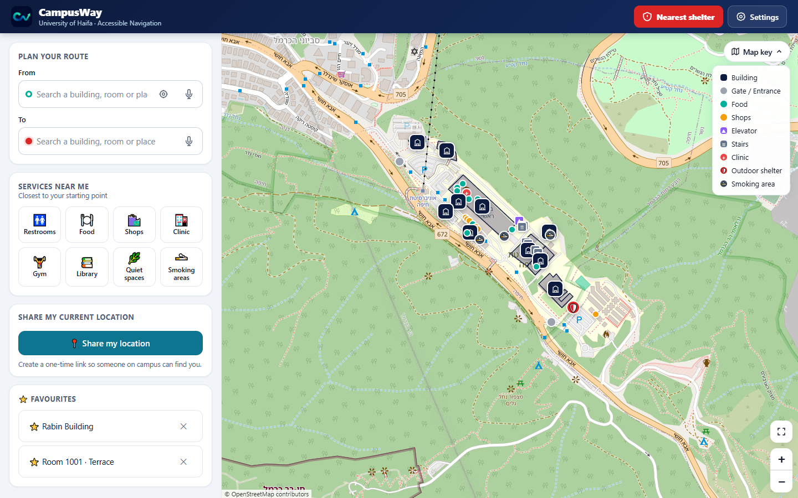 | 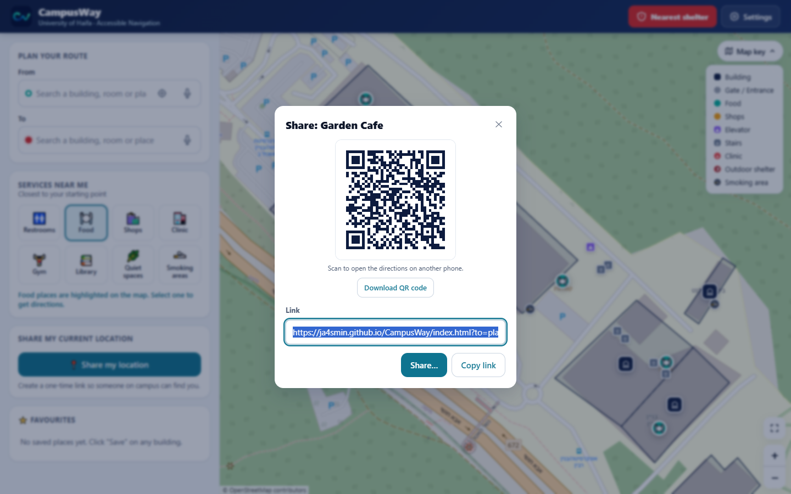 |

## 11. Live campus status and problem reports

| Feature | Description |
|---|---|
| Live campus status | Published by the campus team from the admin screen through the cloud inbox; `app/data/campus-status.json` is the offline fallback. It can list elevator outages, closed indoor areas, outdoor no-go zones, noisy or crowded areas, announcements, an emergency alert, name corrections and opening hours. See [18](18-data-servers-and-offline.md). |
| Effect on routing | Outdoor routes avoid no-go zones and an out-of-service outdoor elevator. Indoor routes skip closed nodes and out-of-service elevators. Closed shelters are never offered. The Sensory & Wellbeing profile avoids noisy or crowded areas. |
| On-screen notices | No-go zones are drawn in red. The outdoor elevator icon shows ✕ when out of service. The route card warns about outages on the way. Popups show opening hours ("Open now · until 18:00"). |
| Announcement and emergency banners | Active announcements appear as banners under the top bar on both pages. Information and warning banners can be closed; critical ones stay. An emergency alert shows a red banner with a **Nearest shelter** button. |
| Report a problem | Users can report an elevator, a restroom or another problem from a building's popup or the outdoor elevator's popup, and report the current conditions of a quiet space from its popup. The report is sent to the campus team through the cloud inbox (kept on the phone and sent later when offline), and the user can later see its status, e.g. *Fixed*. An elevator reported out of service is avoided by the user's own routes for 24 hours. See [18](18-data-servers-and-offline.md#4-what-the-phone-sends). |

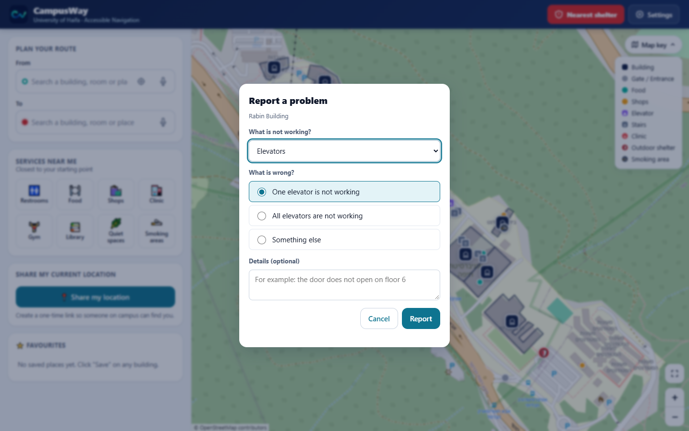

## 12. Progressive Web App and offline use

- Installable to the home screen (web app manifest, standalone display, app icon).
- A service worker pre-caches the app, every indoor graph and every floor plan, so search, routing, indoor navigation and QR codes work offline after the first visit.
- The live campus status is fetched from the cloud inbox when online; offline, the last status received (or the bundled file) is used.
- The base map tiles come from OpenStreetMap and need a connection; offline, the map shows the building outlines, markers and routes on a plain background.

## 13. Developer tools

| Tool | Purpose |
|---|---|
| **WayFrame node plotter** (`wayframe/wayframe.html`) | Visual editor used to draw the indoor graphs on top of floor plans, test routes, and export the JSON. |
| Route tester (`wayframe/route-tester.html`) | Read-only viewer that draws a route over the raw floor plan. |
| Sensor test (`wayframe/sensor-test.html`) | Live step-count and heading readout for tuning on real phones. |
| Audio test / Mic test | Check text-to-speech voices and microphone access on a device. |
| `?demo=1` | Demo mode for presentations: the outdoor walk is simulated and indoor navigation runs in Auto mode, so a whole journey can be shown without walking. |
| `?debug` | Shows coordinates when clicking the campus map. |

See [13 · Developer tools and indoor mapping](13-developer-tools-and-mapping.md).
