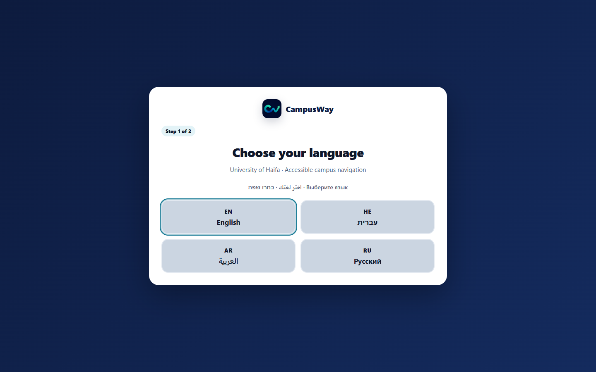
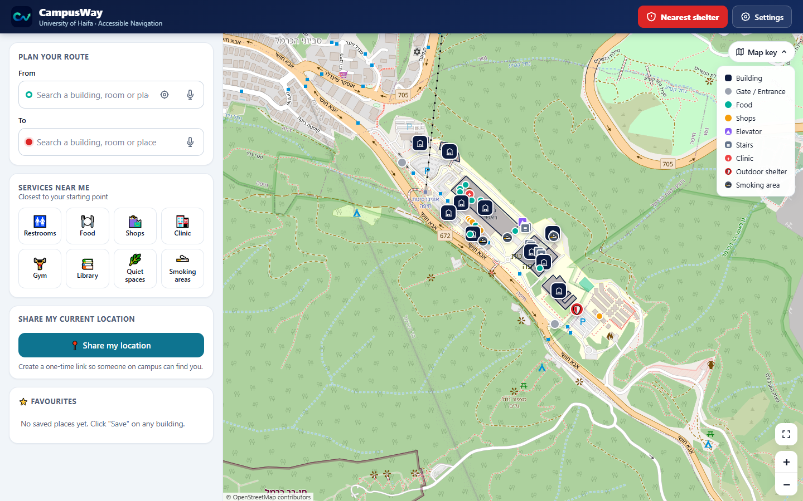
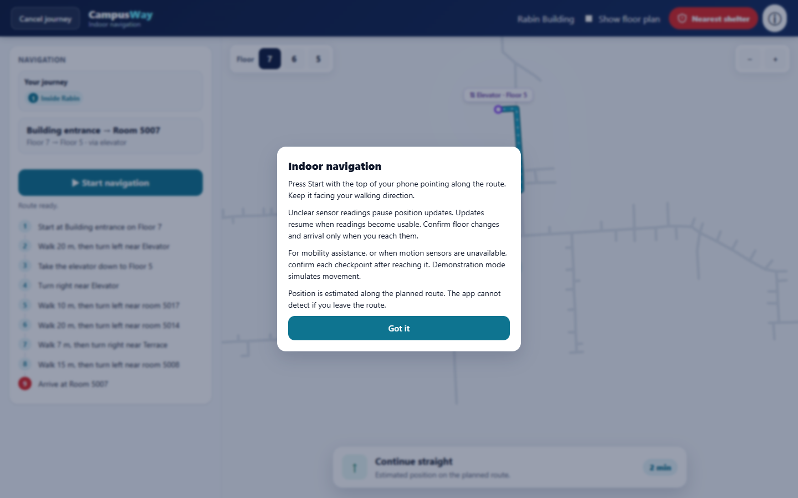
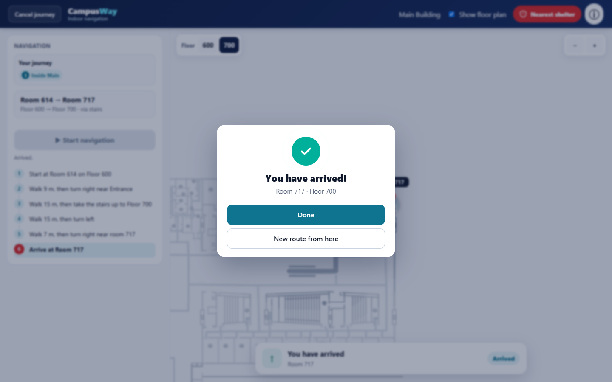
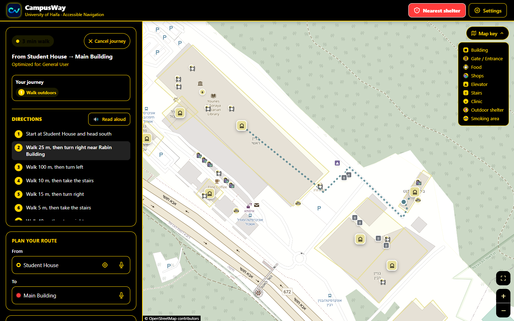

# 03 · User guide

> How to use CampusWay, step by step: from opening the app to arriving at a room. Written for students, visitors and testers. No technical knowledge is needed.

**Contents:** [Open the app](#1-open-the-app) · [Choose a language](#2-choose-a-language) · [The campus screen](#3-the-campus-screen) · [Plan a route](#4-plan-a-route) · [Choose an accessibility profile](#5-choose-an-accessibility-profile) · [Follow outdoor directions](#6-follow-outdoor-directions) · [Navigate indoors](#7-navigate-indoors) · [Find services near you](#8-find-services-near-you) · [Emergency: nearest shelter](#9-emergency-nearest-shelter) · [Favourites](#10-favourites) · [Share a place or your location](#11-share-a-place-or-your-location) · [Report a problem](#12-report-a-problem) · [Display and sound settings](#13-display-and-sound-settings) · [Tips and troubleshooting](#14-tips-and-troubleshooting)

---

## 1. Open the app

- **On a phone or computer:** open <https://ja4smin.github.io/CampusWay/> in Chrome, Edge or Safari.
- **Install it (optional):** in the browser menu choose *Add to Home screen* (Android/Chrome) or *Share → Add to Home Screen* (iPhone/Safari). CampusWay then opens like an app and works offline after the first visit.

Phone-sensor navigation needs the secure **https://** address above. A local network address may not allow sensor access.

## 2. Choose a language

The first time you open CampusWay, a short setup with two steps appears:

1. **Step 1 of 2 · Choose your language:** **English**, **עברית**, **العربية** or **Русский**. Hebrew and Arabic switch the whole layout to right-to-left; Russian stays left-to-right.
2. **Step 2 of 2 · Choose your navigation profile:** pick the profile that fits you (see [section 5](#5-choose-an-accessibility-profile)) and press **Continue**. **Back** returns to the language step.

Both choices are saved on your device, so next time CampusWay opens straight on the campus map. You can change them later in **Settings** (the gear button in the top bar).

## 3. The campus screen

| Area | What it is for |
|---|---|
| Top bar | **Nearest shelter** (red) and **Settings** (gear) |
| Banners | Announcements from the campus team, and a red banner in an emergency |
| Plan your route | *From* and *To* fields; with the Visual Impairment profile, also **Plan route by voice** |
| Route card | Appears when a route is planned: walking time, *From → To*, *Your journey*, directions and **✕ Cancel journey** |
| I need a break | Only with the Sensory & Wellbeing Support profile |
| Services near me | Restrooms, Food, Shops, Clinic, Gym, Library, Quiet spaces (Rest Spaces), Smoking areas |
| Share my current location | Creates a link so someone on campus can find you |
| Favourites | Your saved places |
| Map | Buildings (dark markers), gates, food (green), shops (orange), clinic (red +), elevators, stairs, smoking areas and the outdoor shelter (🛡️). Use **Map key** to see the legend. |

On a phone the map is at the top and the panels are below it; scroll down to see them.

## 4. Plan a route

1. **From** (optional). Leave it empty to start at Carmel Gate, or:
   - type a building or room number and pick a suggestion;
   - press the **target icon** to use your GPS position;
   - press the **microphone** and say the place.
2. **To.** Type a building, a room number (e.g. `5008`), a place (`Aroma`) or a service word (`library`, `toilet`), then pick a suggestion. You can also tap a building on the map and choose **Navigate here**.
3. The route appears on the map, and the **route card** shows the walking time, *From → To*, the stages under **Your journey** (for example *Inside Rabin Building → Walk outdoors → Inside Main Building*) and the directions.

Your profile is applied automatically; there is nothing to choose here.

> **Tip:** Searching a room number shows its building and floor. If the same number exists in two buildings, both are listed.

To stop, press **✕ Cancel journey** on the route card and answer **Yes** to *"Cancel this journey?"* (**No** keeps the route).

**Plan route by voice** (Visual Impairment profile). Press **Plan route by voice**. CampusWay asks where you are starting (say a room or building, or "use my location") and where you want to go, then plans the route and tells you the result. Press **Stop voice planning** to stop at any time. The spoken questions are in English, Hebrew or Arabic.

## 5. Choose an accessibility profile

You choose a profile in step 2 of the first-run setup. To change it later, open **Settings** (gear) → **Navigation profile**, tap the current profile and choose another:

| Profile | Choose it if you… |
|---|---|
| **General User** | want the standard fastest route |
| **Mobility** | use a wheelchair or crutches; stairs are avoided everywhere, and indoors you confirm each checkpoint with a tap |
| **Visual Impairment** | want High Contrast and spoken guidance; you can also plan routes by voice, and Android phones vibrate before turns |
| **Spatial / Navigation** | prefer routes with fewer turns and simple "about 12 m, then turn left" instructions |
| **Sensory & Wellbeing Support** | prefer quieter paths and want help finding a place to take a break |

The current route is recalculated immediately. If no step-free route is mapped for the Mobility profile, CampusWay says so; it does not draw a route that might include stairs.

## 6. Follow outdoor directions

- When a route is drawn, CampusWay follows your GPS position along it: a blue dot shows where you are, and the current step is highlighted.
- With the **Audio Guide** on, the route summary is read out, and each turn is read aloud as you approach it.
- **On a computer**, the **Directions** list is on the route card. Press **Read aloud** to hear all steps, or tap one step to hear only that step.
- **On a phone**, the next direction and its distance are shown in a strip at the bottom of the map. Press **›** to open the full **Directions** list; tap a step to hear it.
- If you see *"Location is imprecise"* or *"You appear to be away from the route"*, guidance pauses until your position is clear again. You can still tap a step to hear it.
- If your journey ends outdoors, **You have arrived!** appears. Choose **Done**, or **New route from here** to start the next route from this place.

## 7. Navigate indoors

When your start or destination is a room, the route card shows a button:

- **Start indoor route →** when you start inside a building (it guides you to the best exit). The outdoor directions appear after you reach the exit.
- **Continue indoors →** when you reach the destination building. It appears when you are about 25 m from the entrance. If your location cannot be found, it appears with the hint *"Tap Continue indoors when you reach the entrance."*

### 7.1 The indoor screen

| Element | What it does |
|---|---|
| Route summary | *Entrance → 5007*, and the floors on the way (*Floor 7 → Floor 5*) |
| Your journey | The stages of a longer journey, with ✓ for the finished ones |
| Start navigation | Starts guidance in the mode chosen for you (see 7.2) |
| Floor buttons | Switch between the floors on your route |
| Show floor plan | Shows the architectural drawing under the route (off by default for a cleaner view) |
| Banner | The current instruction, e.g. *Turn left*, *Take the stairs to Floor 5* |
| Step list | All instructions; tap one to hear it. On a phone, the current step is in a strip over the map |
| Nearest shelter | Routes to the nearest shelter in this building |
| ⓘ | Explains how indoor navigation works |
| ← Campus map | Asks *"Cancel this journey?"*; **Yes** returns to the campus screen |

Indoor voice guidance follows the **Audio Guide** setting.

### 7.2 Navigation modes

You do not choose the mode; CampusWay picks it for you:

| You are… | Mode |
|---|---|
| using the Mobility profile | **Manual / Wheelchair** |
| using demo mode (`?demo=1` in the address) | **Auto** |
| anyone else | **Phone Sensors** |

**Phone Sensors.** The marker moves as you walk.

1. Hold the phone upright in portrait, pointing along the route (the direction of the first segment).
2. Press **Start navigation** and allow motion and orientation access if asked (iPhone shows a permission prompt).
3. Walk normally. The map turns with you, and each detected step moves the marker about 0.65 m along the route.
4. At stairs or an elevator, follow the banner and confirm with the button: *I entered the elevator*, then *I exited on Floor X*; or *I'm on Floor X* for stairs.
5. If you see *Direction unclear*, hold the phone steady and upright; tracking resumes on its own. If asked, point along the route and press Start again.
6. Near the end, check the room sign and press **✓ I have arrived** (or **✓ I reached the exit** when you are leaving the building).

> Phone Sensors mode estimates your position along the planned route. It cannot tell if you leave the route, so check room signs.

If you refuse motion access, or your device has no motion sensors, CampusWay switches to tap-to-confirm checkpoints on the same route (stairs are still allowed), as in Manual mode below.

**Manual / Wheelchair.** No sensors are used. The route is split into checkpoints at turns and elevators.

1. Press **Start navigation**.
2. Follow the banner, e.g. *Turn left and follow the highlighted route, about 9 m to the next turn*.
3. When you reach the shown point, press **✓ I reached the next point**. Use **← Previous point** to go back.
4. At an elevator, press **✓ Reached Floor X** when you exit.
5. At the building exit, press **✓ I reached the exit — continue outdoors**.

With the Mobility profile, this mode always uses a step-free route.

**Auto (demo mode).** The marker walks the whole route by itself and pauses briefly at floor changes. Use it to show a journey without walking.

### 7.3 Arriving

At the destination, **You have arrived!** appears. Choose **Done** to return to the campus map, or **New route from here** to plan the next route starting from this room.

If this indoor leg was only the first part of a longer journey (you started in a room), **You reached the exit** appears instead. Press **Continue outdoors →** to return to the campus map with the outdoor leg drawn, or **Cancel journey**. Press **Continue indoors** when you reach the next building. Between Rabin and the Terrace Building, **You reached the connection** appears; press **Continue →**.

## 8. Find services near you

Use the **Services near me** buttons. Distances are measured from your *From* point.

- **Restrooms, Clinic, Gym, Library** and **Smoking areas** plan a route to the nearest one straight away.
- **Food** and **Shops** highlight the places on the map. Tap one and choose **Navigate here**.
- **Quiet spaces** shows the nearby quiet spaces on the map (🌿), each with its floor and walking time. Tap one and choose **Navigate here**. With the **Sensory & Wellbeing Support** profile this button is called **Rest Spaces**.
- Press an active button again to cancel it.
- With the **Sensory & Wellbeing Support** profile, press **🌿 I need a break** to be guided straight to the nearest rest space.

There is no shelter button in this list. Use the red **Nearest shelter** button in the top bar.

## 9. Emergency: nearest shelter

Press the red **Nearest shelter** button in the top bar. It is also on the indoor screen, and on the red banner when the campus team announces an emergency.

CampusWay starts from your *From* point. If you have not chosen one, it uses your phone's position when you are on campus; otherwise it starts at Carmel Gate and tells you so. It routes you to the fastest reachable protected space, including the outdoor shelter. The route card turns red. Press **Continue indoors** to be guided to the shelter room.

## 10. Favourites

- **Save a building:** tap it on the map → **⭐ Save to Favourites**.
- **Save a place:** food places, shops, smoking areas and quiet spaces have **⭐ Save to Favourites** in their popup.
- **Save a room:** tap the ☆ next to it in the search suggestions.
- **Use a favourite:** tap it in the **Favourites** panel. Remove it with **✕**.

Favourites are stored on your device only.

## 11. Share a place or your location

**Share a place.** In the popup of a food place, a shop or the clinic, press **↗ Share**. **Share my location.** Under *Share my current location*, press **📍 Share my location** and allow location access; the link contains your current position, so someone on campus can find you.

In the share dialog you can:

- show the **QR code** for someone to scan, or **Download QR code** as an image;
- **Copy link**, or use **Share…** to send it through your phone's apps.

Whoever opens the link gets a route to that place. If they have not chosen a start, directions start from their phone's position on campus; otherwise they start at Carmel Gate, with a message.

## 12. Report a problem

In the popup of a mapped building, or of the outdoor elevator, press **Report a problem**. Choose what is not working (e.g. *Elevator 1*) and what is wrong (*Out of service*, *Doors or buttons not working*, *Something else*), and save. A quiet space's popup has **Report** for its current conditions.

An elevator reported out of service is avoided by your routes for 24 hours. The report is sent to the campus team (through the cloud inbox) together with your note; it contains no name or location. If you are offline, it waits on your phone and is sent the next time CampusWay opens. Open the report dialog again later to see its status, for example *Fixed*. See [18 · Data, servers and offline use](18-data-servers-and-offline.md#4-what-the-phone-sends).

## 13. Display and sound settings

Press the gear (**Settings**) in the top bar. Every choice is saved on your device.

| Setting | Effect |
|---|---|
| **Language** | English / עברית / العربية / Русский |
| **High Contrast** | Black and yellow theme with larger-contrast map symbols |
| **Audio Guide** | Speaks actions, routes and directions, outdoors and indoors |
| **Text size** | *Normal* or *Large* text throughout CampusWay |
| **Navigation profile** | Changes how routes are calculated (see [section 5](#5-choose-an-accessibility-profile)) |
| **Schedule reminders** | Optional class reminders (below) |

**Class reminders.** Turn on **Schedule reminders**, then press **Manage my schedule**. Enter the class name, day and time, choose the room or building from the list, and press **Add class**. While CampusWay is open, a **Class soon** card appears 15 minutes before the class. Press **Start route** to be guided there; directions start from your position when you are on campus, otherwise from Carmel Gate. Your schedule stays on your device.

## 14. Tips and troubleshooting

| Problem | What to do |
|---|---|
| The setup screens appear again | Language and profile are saved in this browser on this device. They are lost if the site data is cleared or in a private window. Choose them again. |
| "No step-free route found" | No route without stairs is mapped between these points. Try a different start or destination entrance, or ask for assistance. |
| Phone Sensors switched to tap-to-confirm | Motion access was refused or the sensors gave no readings. CampusWay keeps tap-to-confirm until you close the tab. Next time, use the https:// address, allow motion access and hold the phone upright. |
| The marker drifts | Step length is an estimate (about 0.65 m). Check room signs, and confirm arrival only when you are really there. |
| Directions start at Carmel Gate | No *From* was chosen and your position was unavailable or off campus. Choose a *From* point or press the target icon. |
| No map background | The street map needs internet. Buildings, routes and indoor plans still work offline. |
| Voice search says "not supported" | Speech recognition depends on the browser; Chrome and Edge support it best. |
| No spoken guidance | Turn up the volume and check that the Audio Guide is on. If a card says your device has no voice for the language, follow its steps to add one. |
| Showing the app without walking | Add `?demo=1` to the address (e.g. `https://ja4smin.github.io/CampusWay/?demo=1`). The outdoor walk is simulated and indoor navigation runs in Auto mode. |
