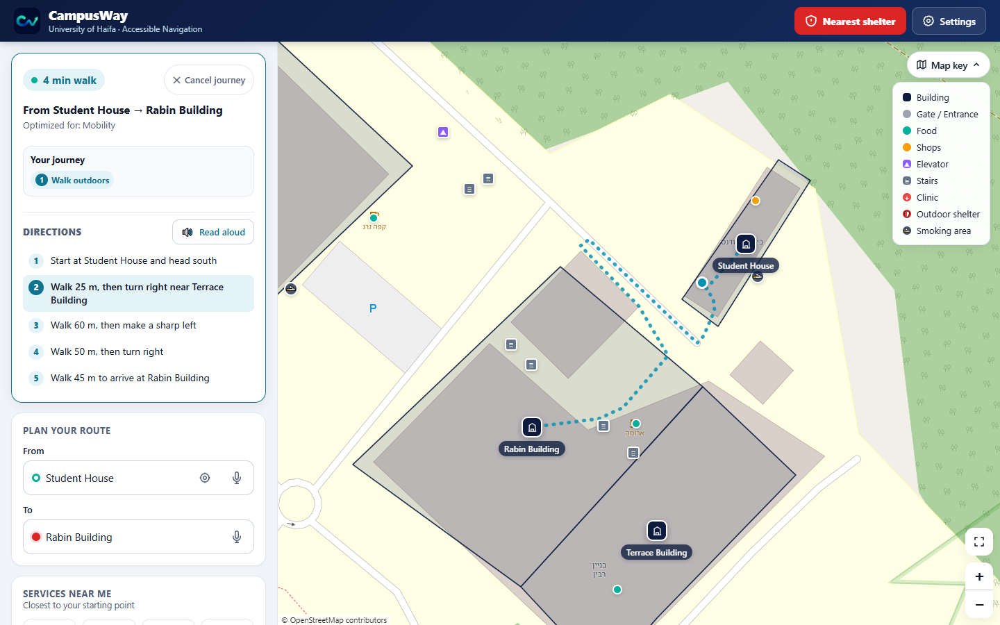

# 12 · Accessibility

> Accessibility is CampusWay's core purpose. This document describes the accessibility profiles, the inclusive-design features of the interface, how step-free routing is kept safe, and the current limits.

**Contents:** [Principles](#1-principles) · [Accessibility profiles](#2-accessibility-profiles) · [Step-free routing in detail](#3-step-free-routing-in-detail) · [Interface accessibility](#4-interface-accessibility) · [Languages and right-to-left](#5-languages-and-right-to-left) · [Limits](#6-limits)

---

## 1. Principles

1. **Honesty over convenience.** If no step-free route is mapped, CampusWay says so; it never draws a route that might contain stairs for a wheelchair user.
2. **More than one way to do everything.** Touch, keyboard, voice input, spoken output and, on Android, vibration.
3. **Different needs, different routes.** Profiles change the route itself, not just the colours.
4. **No sensor dependency for critical use.** Manual / Wheelchair mode works without any sensors, and when motion sensors are refused or unavailable, indoor guidance continues with tap-to-confirm checkpoints automatically.
5. **Language is accessibility.** Hebrew, Arabic and Russian speakers get the full interface (right-to-left for Hebrew and Arabic) and spoken guidance in their language.

## 2. Accessibility profiles

| Profile | Who it is for | Outdoor routing | Indoor routing | Guidance |
|---|---|---|---|---|
| General User | Everyone | Fastest weighted route | Shortest route | Standard |
| **Mobility** | Wheelchair, crutches, walker, stroller | No steps; step-free entrances only; 0.8 m/s walking estimate | Elevators only; Manual / Wheelchair mode, locked step-free | Checkpoint confirmations |
| **Visual Impairment** | Blind and low-vision users | Same as General | Same as General | High contrast and the audio guide switch on; voice guidance indoors; read-aloud directions; *Plan route by voice*; vibration before turns and floor changes and on arrival (Android) |
| **Spatial / Navigation** | People who find complex routes hard (e.g. spatial or cognitive difficulties) | Fewer turns (35° turns cost 6 m) | Fewer turns | Simpler, checkpoint-based indoor instructions |
| **Sensory & Wellbeing Support** (formerly *Mental Health Support*; internal id `mental`) | People who need a quiet break or feel overwhelmed | Prefers paths away from areas marked noisy or crowded in the live status (not on emergency routes) | Standard | An *I need a break* button suggests a nearby rest space; the *Quiet spaces* service button becomes *Rest Spaces* |

The profile is chosen in the two-step first-run setup (language, then profile) and can be changed in Settings. It is saved on the device (`localStorage`), so it is kept after the browser is closed, and it is passed to the indoor page. Language, the audio guide, high contrast and text size are remembered the same way.

**The indoor navigation mode is chosen automatically:**

| Situation | Indoor mode |
|---|---|
| Mobility profile | Manual / Wheelchair: tap to confirm each checkpoint, step-free only |
| Demonstration mode (`?demo=1`) | Auto: the marker moves along the route by itself |
| Every other profile | Phone Sensors: the marker moves as steps are detected |
| Motion sensors refused, or no readings arrive | Tap-to-confirm checkpoints on the same route (stairs stay allowed outside the Mobility profile), kept for the rest of the visit |

## 3. Step-free routing in detail

| Layer | What is excluded |
|---|---|
| Outdoor paths | All `steps` edges (OpenStreetMap and hand-mapped stairs) |
| Building entrances | Entrances marked `requiresStairs` or `avoidForMobility` |
| Indoor graph | Every stairs node and every stair link between floors |
| Building transfers | Rabin ↔ Terrace uses the shared elevator (Rabin floor 5 ↔ Terrace floor 4), for every profile; while it is out of service, journeys go around it outdoors |
| Live status | Elevators reported out of service (official status or user reports) |

When the filtered graph has no path, the user sees *"No step-free outdoor route found"* or *"No step-free route found"*, and the ETA shows "—". Automated tests check that no fallback line is drawn in this case.

| Mobility route (stairs avoided) | Manual / Wheelchair indoor mode |
|---|---|
|  |  |

## 4. Interface accessibility

| Feature | Details |
|---|---|
| First-run setup | Two short steps (language, then profile) with a progress label; everything can be changed later in Settings |
| High-contrast mode | Black and yellow (#FFD400) theme; map markers redrawn with high-contrast symbols. Remembered on the device; the Visual profile switches it on, and the user's own choice wins |
| Text size | *Normal* or *Large* in Settings, remembered on the device and applied on the indoor page too |
| Touch targets | Main controls are at least 44 × 44 px; a few secondary buttons (close ✕, *Read aloud*, *Share*) are 30–36 px |
| Keyboard | Controls are standard buttons and inputs, so they can be reached with Tab; suggestion lists use the arrow keys, Enter and Escape; the language menu supports the arrow keys and Escape; indoor steps can be read with Enter or Space |
| Focus | Visible focus ring (design token) |
| ARIA | Combobox/listbox pattern for search, `aria-pressed` on mode buttons, `role="status"` / live regions for route status and messages, labelled icon buttons |
| Map markers | Every marker on the campus map has a name (building, place, restroom, elevator and whether it is out of service) that screen readers announce; the names follow the language |
| Dialogs | Native `<dialog>` with focus handling for share, report and arrival (indoors, and *You have arrived!* at the end of an outdoor journey) |
| Reduced motion | The indoor route animation and the voice meter respect `prefers-reduced-motion` (the outdoor route dash still animates) |
| Spoken output | Audio guide, *Read aloud* directions, indoor voice guidance, spoken steps during live outdoor guidance; each step can be read on its own |
| Voice input | Speech recognition for the start and destination fields; *Plan route by voice* for the Visual profile |
| Vibration | Visual profile: one pulse before a turn or steps, two for a floor change indoors, three long pulses on arrival (`app/ui/haptics.js`). Android only |
| Readable text | System font stack, clear hierarchy, plain-language instructions with distances and landmarks |
| Non-colour cues | Icons and text labels together with colour (e.g. elevator ▲ / ✕, legend entries) |

## 5. Languages and right-to-left

- English, Hebrew, Arabic and Russian for the interface, directions and spoken messages (a few messages are still English only, see [Limits](#6-limits)).
- Hebrew and Arabic use `<html dir="rtl">` with CSS logical properties, so the layout mirrors cleanly; Russian and English are left to right. Route arrows flip (→ / ←).
- Search understands all four languages and their letter variants (Hebrew final letters and niqqud, Arabic diacritics and letter forms).
- In Arabic, building names are shown in Arabic with the Hebrew name in brackets, for example المبنى الرئيسي (בניין ראשי).
- Speech uses `he-IL`, `ar-SA`, `ru-RU` and `en-US` voices when the device has them. When a language has no voice on the device, the app explains how to add one.

## 6. Limits

- Accessibility depends on how complete and accurate the mapping is. A calculated route does not check current conditions (construction, crowds, a broken door) unless they are entered in the live status or reported.
- Some areas have no step-free connection mapped, e.g. Terrace Building floors 0 and −1 have no mapped elevator.
- Phone Sensors mode is an estimate. It does not detect leaving the route, and it is not recommended for wheelchair use (Manual mode is used instead).
- Vibration works only in Android browsers; iPhones do not support it, so it only adds to the spoken and on-screen guidance.
- In Arabic, food places and shops are shown with their Hebrew names.
- A few messages are still English only, e.g. the *Plan route by voice* questions in Russian.
- A full screen-reader audit with TalkBack and VoiceOver is recommended (see [14 · Limitations and future work](14-limitations-and-future-work.md)).
