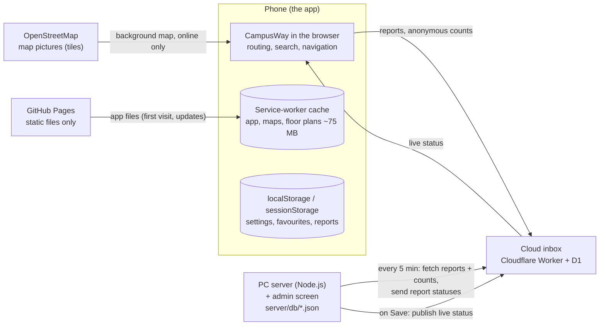

# 18 · Data, servers and offline use

> Where CampusWay runs, what it stores, where it stores it, and what it sends. In short: **the app runs on the phone and relies mostly on offline files and the browser cache.** Two small services exist only for problem reports, anonymous usage counts and the live campus status. Navigation never depends on them.

**Contents:** [In one minute](#1-in-one-minute) · [What runs where](#2-what-runs-where) · [On the phone](#3-on-the-phone) · [What the phone sends](#4-what-the-phone-sends) · [Cloud inbox database](#5-the-cloud-inbox-cloudflare-worker--d1) · [PC server database](#6-the-pc-server-nodejs--json-files) · [When something is down](#7-when-something-is-unreachable) · [Privacy summary](#8-privacy-summary)

---

## 1. In one minute

- **Offline first.** The app is plain files hosted on GitHub Pages. On the first visit the service worker saves the whole app on the phone: pages, scripts, every indoor map, every floor plan and the outdoor path network (about 75 MB). After that, search, routing, indoor and outdoor navigation, shelters and QR codes work without a connection.
- **All computing happens on the phone.** Routes are calculated in the browser. No server calculates routes or sees where you are.
- **No user accounts.** Nobody signs in to use the app.
- **Two small services, for the campus team:**
  1. **Cloud inbox:** a free Cloudflare Worker with a small Cloudflare D1 (SQLite) database. It receives problem reports and anonymous counts from phones, and hands out the live campus status.
  2. **PC server:** a Node.js program on one campus-team PC, with the admin screen. Its "database" is a folder of JSON files on that PC (`server/db/`). It collects reports from the inbox and publishes the live status to it.
- **What leaves the phone:** problem reports the user chooses to send, anonymous usage counts (no names, device ids, locations or times of day) and a request for the latest campus status. Nothing else.

## 2. What runs where

| Part | What it is | What it does | Needed for navigation? |
|---|---|---|---|
| **The app** | `index.html`, `wayframe/navigation-demo.html` and their scripts, running in the phone's browser | Everything the user sees: routing, search, indoor and outdoor guidance, shelters, settings | Yes, and it runs entirely on the phone |
| **Service-worker cache** | `service-worker.js` + the browser's Cache Storage | Keeps a copy of every app file, indoor graph, floor plan and the outdoor path network | Yes, it is what makes the app work offline |
| **GitHub Pages** | Static file hosting | Delivers the app files over HTTPS. It runs no code and stores no user data | Only for the first visit and updates |
| **OpenStreetMap tiles** | Public map pictures | The street background of the campus map | No. Offline, routes and markers still show on a plain background |
| **Cloud inbox** | Cloudflare Worker `campusway-inbox` with the D1 database `campusway-inbox` (code in [`cloud/`](../cloud/README.md)) | Receives reports and anonymous counts; serves the live status | No |
| **PC server** | `server/campusway-server.js` (Node.js, built-in modules only) on one campus-team PC | Admin screen, keeps reports and history, publishes the live status | No |

## 3. On the phone

### Saved for offline use (Cache Storage)

On the first visit the service worker downloads and keeps everything in `APP_FILES`: both pages, all scripts and styles, the campus data, the outdoor path network (`campus-osm.json`), every indoor graph and every floor plan, about 75 MB.

| Request | How it is answered |
|---|---|
| Pages, scripts, styles | **Network first**, then the saved copy. A new release shows up at once; offline, the saved copy is used. |
| `.json` and `.svg` (indoor maps, floor plans, live-status file) | **Network first**, then the saved copy, so map fixes and new outages appear immediately. |
| Images and everything else from the site | **Cache first**, then the network. |
| `/api/…`, the admin screen | Never cached. |
| OpenStreetMap tiles | Not cached by CampusWay (the browser may keep some on its own). |

A release replaces the cache when `CACHE_NAME` in `service-worker.js` changes (now `campusway-v68-fresh-maps`), or when the file list changes.

### Stored in the browser

All of this stays on the phone and is never uploaded, except the problem reports (see section 4).

| Kept until cleared (`localStorage`) | Contents |
|---|---|
| `campuswayLanguage`, `accessibilityProfile`, `campuswayOnboardingComplete` | Language, navigation profile, first-run setup done |
| `campusway.audioEnabled`, `campusway.highContrastEnabled`, `campusway.textSize`, `campuswayIndoorVoice` | Display and audio settings |
| `campusway.favourites.v1` | Saved places |
| `campusway.scheduleRemindersEnabled`, `campusway.scheduleEntries` | Optional class reminders |
| `campuswayReports` | The user's own problem reports (last 50, used for 14 days, e.g. to avoid a reported elevator for 24 hours) |
| `campuswayStatusCache` | The last live campus status received, used when offline |

| Kept for the visit (`sessionStorage`) | Contents |
|---|---|
| `journeyPlan`, `journeyStage`, `indoorContext`, `indoorStartContext`, `sharedIndoorTransfer`, … | The journey being walked, handed between the campus map and the indoor page |
| `campuswayDismissedAnnouncements` | Banners the user closed |

The phone's GPS position, compass and motion readings are used on the phone only and are never stored or sent. The one exception is **Share my location**: it creates a link containing the position, and only the user decides where to send it.

## 4. What the phone sends

| What | When | To where | Contents |
|---|---|---|---|
| **Live-status check** | Each time the app opens | Cloud inbox, `GET /api/status` | A plain request; the answer is the current outages, closures, announcements, names and opening hours |
| **Problem report** | When the user presses **Report** | Cloud inbox, `POST /api/reports` | What is broken (building, elevator or place, problem type), the optional note (max 500 characters), language and time. No name, no contact details, no location |
| **Report status check** | When the user opens the report dialog | Cloud inbox, `GET /api/reports/status` | Only the ids of the user's own reports, to show "Fixed" |
| **Anonymous usage counts** | When the app opens, a route is requested, a search finds nothing, no step-free route exists, or indoor navigation starts | Cloud inbox, `POST /api/usage` | One word for the type (`language`, `profile`, `route`, `search-miss`, `no-step-free`, `indoor-mode`) plus one value (e.g. the destination name or the unmatched search text, max 80 characters). Nothing that identifies the person or the device |

- If the app is opened **from the PC server** (for example `http://localhost:8080`), the same requests go to the PC instead of the inbox.
- If no service can be reached, reports wait in `campuswayReports` on the phone and are sent the next time the app opens. Counts made while offline are simply not sent.
- The address of the inbox is the `reportEndpoint` field in `app/data/campus-status.json`.

## 5. The cloud inbox (Cloudflare Worker + D1)

**What it is:** one small program (`cloud/worker.mjs`) on Cloudflare's free plan, with one D1 database. D1 is Cloudflare's hosted SQLite. Address: `https://campusway-inbox.campusway.workers.dev/`.

**What it stores** (tables from `cloud/schema.sql`):

| Table | One row is | Kept for |
|---|---|---|
| `reports` | One problem report: id, time received, the report as JSON (`payload`), status (new → resolved / rejected) | The report text is **deleted as soon as the PC fetches it**; only the id and status stay, for 60 days, so the reporter can see "Fixed". Reports the PC never fetches are deleted after 90 days. |
| `usage` | Day + type + value + count, e.g. `2026-10-11 · route · Rabin Building · 14` | Deleted as soon as the PC fetches it |
| `live_status` | The single, current live campus status (JSON) | Replaced on every publish |
| `hits` | Hourly request counters for rate limiting, keyed by a **hashed** address (the address itself is never stored) | Two hours |

**How it is done:**

| Endpoint | Who calls it | What happens |
|---|---|---|
| `GET /api/health` | The app | Tells the app the inbox is there |
| `GET /api/status` | The app | Returns the live status |
| `POST /api/reports` | The app | Stores up to 20 reports per request; duplicates are ignored |
| `GET /api/reports/status` | The app | Returns the statuses of the given report ids |
| `POST /api/usage` | The app | Adds 1 to a day's count |
| `POST /api/sync` | The PC server only, with the **sync key** | Returns waiting reports and counts, receives report statuses, then deletes what the PC confirmed |
| `PUT /api/status` | The PC server only, with the **sync key** | Replaces the live status |

**Protection and limits:** only the GitHub Pages site (and `localhost:8080` for testing) may call it from a browser. The sync key is compared in constant time and is kept only in Cloudflare and in `server/db/cloud.json` on the PC, never in the repository. Caps: 30 reports per hour per device, 1,000 reports and 20,000 counts per day for the whole inbox, 100 MB database. All of this stays far inside Cloudflare's free plan; going over a cap makes requests wait until the next day and never creates a bill. Set-up and re-keying: [`cloud/README.md`](../cloud/README.md).

## 6. The PC server (Node.js + JSON files)

**What it is:** `server/campusway-server.js`, one Node.js file that uses only Node's built-in modules (no packages, no database software). It runs on one campus-team PC (`node server/campusway-server.js` or `start-admin.bat`). Details of the admin screen: [17 · Admin screen](17-admin-screen.md).

**What it does:**

- Serves the app and the admin screen at `http://localhost:8080` (only a fixed allow-list of app files; never `server/`, `.git` or hidden files).
- Runs the admin API. It works only from the PC itself unless started with `--lan-admin`. Sign-in uses salted scrypt password hashes and an HttpOnly, SameSite=Strict session cookie.
- **Every 5 minutes:** asks the cloud inbox (`POST /api/sync`) for new reports and counts, stores them, and sends back report statuses.
- **On Save to live status:** validates the status, keeps a backup, writes `app/data/campus-status.json` on the PC and publishes it to the inbox (`PUT /api/status`). Phones get it the next time they open the app; no commit is needed.

**What it stores:** plain JSON files in `server/db/`. This folder is in `.gitignore` and is never committed.

| File | Contents | Limit |
|---|---|---|
| `users.json` | Admin accounts: name, role, salted scrypt password hash | – |
| `reports.json` | Problem reports with status, assignee, internal note and history | 5,000 |
| `usage.json` | Anonymous daily counts | About 400 days |
| `audit.json` | Activity log: who changed what, when | 5,000 entries |
| `status-history/` | The live status as it was before each save | Last 200 |
| `cloud.json` | Inbox address, sync key, last fetch, any unconfirmed batch | – |
| `tests.json` | The last test run from the admin **Tests** page | – |

**How it writes:** each change is written to a temporary file and then renamed over the old one, so a crash never leaves a half-written file. Backing up means copying the folder. Everything is capped at 10 GB in total (`--max-data-gb`); in practice the folder stays in the megabytes.

## 7. When something is unreachable

| Situation | What still works | What waits |
|---|---|---|
| Phone offline (after the first visit) | Search, routing, indoor and outdoor navigation, shelters, favourites, settings, QR codes | The street background, new live status (the last one received is used), sending reports (queued on the phone) |
| Cloud inbox down | Everything in the app; the last saved status is used, or the bundled `app/data/campus-status.json` | Reports stay on phones; new announcements and outages are not delivered |
| PC off | Everything in the app and the inbox | Reports wait in the inbox (up to 90 days) until the PC fetches them; the admin screen is unavailable |
| GitHub Pages down | Phones that already have the app keep working from the cache | First visits and updates |

## 8. Privacy summary

- No accounts, no names, no contact details, no device ids, no advertising or third-party analytics.
- Location and sensor readings never leave the phone (except a link the user shares on purpose).
- Problem reports contain only what the user chose and typed. The inbox deletes the report text once the PC has fetched it.
- Usage counts are totals per day; they cannot be linked to a person, a device or a time of day.
- Rate limiting uses a keyed hash of the network address, never the address itself, and expires after two hours.
- Admin data stays on one PC in `server/db/`, which is never committed to the repository.
